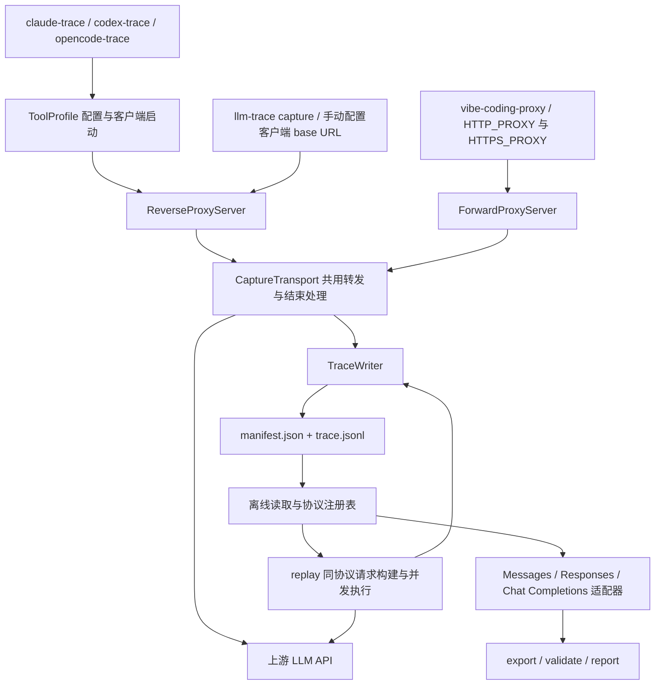

# 项目架构与数据流

claude-trace 5 的核心是记录 LLM HTTP 请求，再离线解析、校验、导出和重放。客户端名称决定启动与配置方式；**协议决定请求和响应的解释方式**。

## 入口与分层

图中的 replay 复用协议适配器、`Exchange` 和 `TraceWriter`；它有自己的 HTTP 请求与超时编排，并不经过 `CaptureTransport`。客户端本身执行工具和推进对话，采集器只观察 HTTP。

| 层 | 职责与源码 |
| --- | --- |
| CLI | [llm-trace.ts](../src/cli/llm-trace.ts) 分派通用命令；[client-launcher.ts](../src/cli/client-launcher.ts) 解析启动器参数；[trace-runner.ts](../src/cli/trace-runner.ts) 管理客户端生命周期 |
| 客户端 profile | [tools/types.ts](../src/tools/types.ts) 定义配置接口，`tools/claude.ts`、`codex.ts`、`opencode.ts` 发现可执行文件、上游路由并创建配置覆盖 |
| 代理与传输 | [reverse-proxy.ts](../src/intercept/reverse-proxy.ts)、[forward-proxy.ts](../src/intercept/forward-proxy.ts) 保留各自路由；[transport.ts](../src/intercept/transport.ts) 处理 HTTP 转发、响应 chunk、取消和异常结束 |
| 存储 | [store.ts](../src/trace/store.ts) 定义 Exchange、TraceWriter、manifest 范围的文件发现和 schema-v2 读取 |
| 协议 | [types.ts](../src/protocols/types.ts) 定义 TraceRecord、ProtocolAdapter、ExportOptions、ValidationResult；[registry.ts](../src/protocols/registry.ts) 实现识别、JSON/SSE 解析、校验、转换与 replay 参数映射 |
| 离线编排 | [offline.ts](../src/trace/offline.ts) 负责导出策略、轨迹关联、校验报告；[replay.ts](../src/trace/replay.ts) 负责选行、认证、并发和保存；[report.ts](../src/trace/report.ts) 生成 HTML |
| 库接口 | [index.ts](../src/index.ts) 导出适配器、存储、代理及通用离线函数 |

当前启动器统一使用反向代理，不存在按可执行文件类型选择 fetch hook 的现行路径。通用 HTML 由 `trace/report.ts` 离线生成，不能将仓库中仍保留的旧展示组件当作默认采集链路。

## 客户端与协议

| 协议 ID | operation | 典型请求结构 |
| --- | --- | --- |
| `anthropic-messages` | `messages` | 顶层 system、messages、content blocks |
| `openai-responses` | `responses` | instructions、input/output items |
| `openai-chat-completions` | `chat/completions` | messages、choices、tool_calls |

显式格式和 profile 的路由信息可用于指定协议；否则根据 URL 与请求体识别。未知请求仍保存原始内容并附 `unknown_protocol` 诊断，不默认解释成 Messages。指定 `--api-format` 只改变识别/解释，不转换网络协议。

通用反向代理一个实例对应一个上游；既有 profile 可以提供多 provider/model 路由。Claude 和 Codex 使用配置覆盖目录，OpenCode 注入子进程配置；原始用户配置不被就地改写。离线命令不加载 profile，也不运行客户端查版本。

## 记录和 manifest

每次运行生成新的 `run_id`，每条记录生成采集器自己的 `request_id`。**一条 JSONL 对应一次请求尝试及其完整或部分响应**，重试也是独立记录。采集器 ID 不等于服务端返回的 response ID。

| 数据 | 内容 |
| --- | --- |
| manifest | schema_version=2、run_id、trace_file、客户端及版本（若有）、collector_version、配置摘要、开始/结束时间、running/complete/incomplete 状态 |
| TraceRecord | schema_version、run_id、request_id、protocol、request、response、status、可选 error/diagnostics、timing、logged_at |
| request | 方法、URL、脱敏后的 headers、解析后的 body、可用时的 body_raw 或编码数据 |
| response | HTTP 状态、headers、原生 JSON body 或完整 SSE body_raw；不会用展示结构替换 SSE 原文 |
| timing | start_ms、headers_ms、first_chunk_ms、end_ms；缺失阶段为 null，均为毫秒时间戳 |
| replay source | 原始 file、物理 line、request_id，用于关联来源；并发完成顺序不影响来源身份 |

gzip/br/deflate 等只在存储解释时解码；无法解码的内容保存编码信息及 base64，转发仍使用原始字节。原始内容保全受头部脱敏规则限制；正文、URL 和查询参数不是通用秘密清洗的对象。

记录在请求结束或异常收尾时追加。连接失败、断流、客户端取消和正常停机会保存已有内容；这不是增量事件日志，不承诺 SIGKILL 或掉电时在途请求恢复。SSE 解析不伪造事件到达时间。

显式文件输入直接读取；目录输入只递归发现有效 manifest 指向的 trace，不扫描所有 JSONL。旧 schema 不自动转换。已有 trace/manifest 和离线输出不会被覆盖。

## 导出与轨迹关联

1. 校验原始记录，只有成功、完整且可转换的模型返回进入训练导出。
2. 协议适配器转换为规范化 history、answer、tools、usage 和推理来源信息。Messages system、Responses instructions 映射为前置 system；工具调用与结果统一表达。
3. 按 run、协议、明确 session 标识分区，匹配**应用导出选项前**的规范化历史。模型与工具定义也参与延续判断；使用唯一最长历史前缀连接轨迹。
4. 歧义、压缩、工具变化或分叉产生新片段，metadata 和诊断记录原因。不会跨 run 或协议拼接。
5. 对关联后的序列依次执行 developer 转 system、保留第一条 system、合并 system。未启用的步骤不执行；默认合并分隔符是双换行，可显式指定空字符串。

规范化恢复模板需要的行为：过滤派生 system 中的 billing 标记；OpenAI 文本块按换行拼接；Responses 函数定义按稳定字段顺序输出。完整 reasoning 文本、summary、encrypted 字段的角色分开处理，摘要不充当完整推理。这些都不改变原始采集或转发。

输出为 `messages + tools + metadata`：实际成功回答标记 `trainable: true`，仅作为历史引入的消息为 false，已匹配的历史回答保留其训练目标身份。metadata 记录协议、来源请求、rounds、usage、片段原因和推理来源。无法保留的 developer 专有语义、未支持的多模态/工具等产生跳过诊断；导出数量需结合诊断查看。

`trainable` 不是已经生成的 token loss mask。训练框架还需按相同模板、tokenizer 和消息边界实现目标掩码，避免把 system、用户文本、工具结果当作助手答案训练。

## 校验、报告与重放

| 校验维度 | 判断内容 |
| --- | --- |
| capture_complete | 是否有完整收尾，或明确的连接错误结束；是否存在截断传输 |
| protocol_valid | 请求字段、JSON/SSE、终止标记、工具参数及已有工具结果关系是否合法 |
| http_success | 是否为 HTTP 2xx |
| model_complete | 是否达到协议定义的正常模型结束状态；长度截断和失败不算成功 |

完整的 401/429 可以是有效采集，但不是成功训练样本；有明确错误的连接失败也不等于模型成功。工具历史不要求最终 tool call 已有下一轮结果。validate 另外检查重复 ID、时间顺序、未脱敏头、manifest 状态，写独立报告而不清洗输入；显式 incomplete 不会被升级。

report 输出可搜索的独立 HTML，包含校验结果、规范化视图、原始请求/响应与时间。规范化失败会展示诊断，原始内容仍可查阅。

replay 先验证全部选中请求，按原协议构建目标 operation；只从指定环境变量获取新认证，不重用源认证头。并发 worker 执行单次 HTTP 请求，超时/取消也写新 trace，最终保存 `replay.json`。它支持模型、token 上限和 stream 覆盖，但拒绝 previous_response_id 等服务端历史依赖，不执行工具、不续跑下一轮，也不进行跨协议转换。

## 扩展与验证

- 新客户端若能配置 base URL，直接使用通用 capture，无需代码改动。需要自动启动时增加 ToolProfile 和薄 CLI；不要复制协议解析器。
- 新协议需增加协议标识、识别规则和适配器行为，以及端点、JSON/SSE、错误、导出、重放的测试；共用文件遍历、存储和并发机制继续复用。
- 协议/传输改动运行 typecheck、单测、构建及 `test:built`；模型模板兼容性还需要实际 prompt 比较，HTTP 成功和单测通过不能替代它。

进一步阅读：[完整命令参考](usage.md) · [Qwen 导出与验证](vllm-qwen-export.md) · [开发约定](../CLAUDE.md)。
