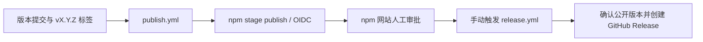

# 发布 npm 包

适用于本仓库的 `@uvl000/claude-trace`。下面说明如何从版本提交走到公开 npm 包及 GitHub Release；本地打包检查不等于发布成功。

## 当前发布流程



| 工作流 | 触发 | 职责 |
| --- | --- | --- |
| [ci.yml](../.github/workflows/ci.yml) | main/master 分支 push、PR | 安装依赖、typecheck、单测、构建、Claude CLI 帮助检查 |
| [publish.yml](../.github/workflows/publish.yml) | `v*` 标签 push；或手动传入已有 tag | 校验版本、检查并构建，通过 OIDC **暂存** npm 包 |
| [release.yml](../.github/workflows/release.yml) | 人工审批后，手动传入 tag | 校验公开 npm 版本，创建同名 GitHub Release；已有 Release 则跳过 |

推标签不会直接完成整个发布。`publish.yml` 的成功表示暂存步骤完成，不代表包已经公开，也不会自动触发 `release.yml`。

## 环境与一次性配置

- 项目运行要求 Node.js **20+**；发布与 Release 工作流使用 Node.js **24**。普通 CI 当前仍使用 Node.js 20。
- 暂存工作流安装 `npm@^11.15.0`，并检查 npm 至少为 11.15，以支持 `npm stage publish`。这与项目运行时的 Node 要求是两回事。
- 本地需要 Git、构建依赖；下文的 Actions 操作示例另需已经登录的 `gh` CLI，也可以在 GitHub 网页执行。
- 仓库地址：[FlyingFish-233/claude-trace](https://github.com/FlyingFish-233/claude-trace)。远端名示例使用 `origin`，发布前检查它确实指向目标仓库。

在 npm 包设置中配置 GitHub Actions Trusted Publisher，预期字段为：

| 字段 | 预期值 |
| --- | --- |
| Organization / user | `FlyingFish-233` |
| Repository | `claude-trace` |
| Workflow filename | `publish.yml`，不带目录 |
| Environment | 留空，与当前 workflow 一致 |
| 能力 | 允许该身份执行 staged publishing |

这些值来自仓库配置，**不表示已经读取并核实 npm 网站的账户设置**。维护者需在 [npm 包设置](https://www.npmjs.com/package/@uvl000/claude-trace/access) 中确认 Trusted Publisher、权限和审批要求。发布工作流使用 `contents: read`、`id-token: write`，不需要在仓库保存 `NPM_TOKEN`；Release 工作流另使用 `contents: write`。

## 1. 检查与创建版本

先同步目标分支并确认工作区干净。以下示例创建一个 patch 版本；新增兼容功能选 minor，破坏性变化选 major。

```bash
git switch main
git status --short
git remote -v
npm ci --ignore-scripts
npm --prefix frontend ci --ignore-scripts
npm run typecheck
npm run test:unit
npm run build
npm run test:built
npm pack --dry-run --ignore-scripts
npm version patch -m "chore: release v%s"
git show --stat HEAD
git describe --tags --exact-match HEAD
```

`npm version` 更新版本文件、创建提交和匹配的 `vX.Y.Z` 标签。检查包名、版本、文件列表及标签；不要重复发布注册表已有的版本，也不要为修复已公开版本而移动旧标签。

如需制作本地、未发布的 npm tarball，可在干净且已提交的工作区运行：

```bash
bash scripts/pack-workflowexp.sh releases
```

该脚本执行依赖安装、检查、构建和五个 CLI 帮助检查，生成 `.tgz`、`.sha256`、`.json` 来源侧文件。它不发布 npm，也不制作外部 WorkflowExp 的最终安装包。脚本实现见 [pack-workflowexp.sh](../scripts/pack-workflowexp.sh)。

## 2. 推送标签并检查暂存任务

```bash
git push origin HEAD
git push origin "$(git describe --tags --exact-match HEAD)"
gh run list --workflow publish.yml --limit 5
```

在 Actions 页面打开对应 tag 的运行；或使用 `gh run view RUN_ID --log-failed` 查看失败步骤。工作流会核对 tag 是否等于 `v` 加 `package.json.version`，然后安装依赖、检查、构建、预览包内容并执行 `npm stage publish`。

已有标签需要手动启动暂存时：

```bash
gh workflow run publish.yml -f tag=vX.Y.Z
```

将 `vX.Y.Z` 替换为实际存在的标签。认证或暂存失败时先确认 npm 上是否已有待审批包，避免把重试当作无副作用的操作。

## 3. 在 npm 审批并确认公开版本

通过暂存任务提供的信息及 npm 网站进入相应包版本，核对来源和版本，按网站要求完成维护者审批及 2FA。审批后查询指定版本：

```bash
npm view @uvl000/claude-trace@X.Y.Z version --prefer-online
```

应返回 `X.Y.Z`。查询指定版本，而不只检查 `latest`，可避免把其他版本误认为本次发布。具体账户审批状态以 npm 网站为准。

## 4. 创建 GitHub Release

确认包已公开后执行：

```bash
gh workflow run release.yml -f tag=vX.Y.Z
gh run list --workflow release.yml --limit 5
gh release view vX.Y.Z
```

Release 工作流查询目标 npm 版本，最多尝试 10 次、间隔 3 秒；不可见则失败。它不会替代人工审批，也不会再次暂存包。成功时创建同标签 Release，自动生成变更说明；同名 Release 已存在则跳过。

## 故障处理

| 现象 | 检查与处理 |
| --- | --- |
| 推标签后没有任务 | 确认标签已推送、符合 `v*`、目标 tag 包含正确 workflow；必要时手动触发该 tag |
| tag 与包版本不一致 | 核对标签指向的提交；修正版本并使用正确的新标签，不让 Release 指向另一份源码 |
| OIDC、权限或 404 错误 | 检查 npm 的 owner/repo/workflow/environment、暂存权限，以及任务中 Node/npm 版本 |
| 暂存成功但 npm 查不到公开版本 | 查看待审批状态、完成审批，等待注册表同步；不要直接进入 Release 步骤 |
| 包已公开、Release 失败 | 只重试 `release.yml`；它会重新确认公开版本，无需重跑暂存 |
| 同版本已存在 | 检查是否已经完成发布；需修改代码时使用新版本 |
| HTTPS push 无法更新 workflow | 只有此次提交包含 workflow 修改时才检查 Git 凭据的对应权限；与 npm OIDC 身份分开处理 |

发布后可在独立验证环境安装指定版本并检查 `llm-trace --help`。不要为了验证文档而替换正在使用的安装。

相关文档：[命令使用](usage.md) · [架构](architecture.md) · [npm Trusted Publishers](https://docs.npmjs.com/trusted-publishers/)。
